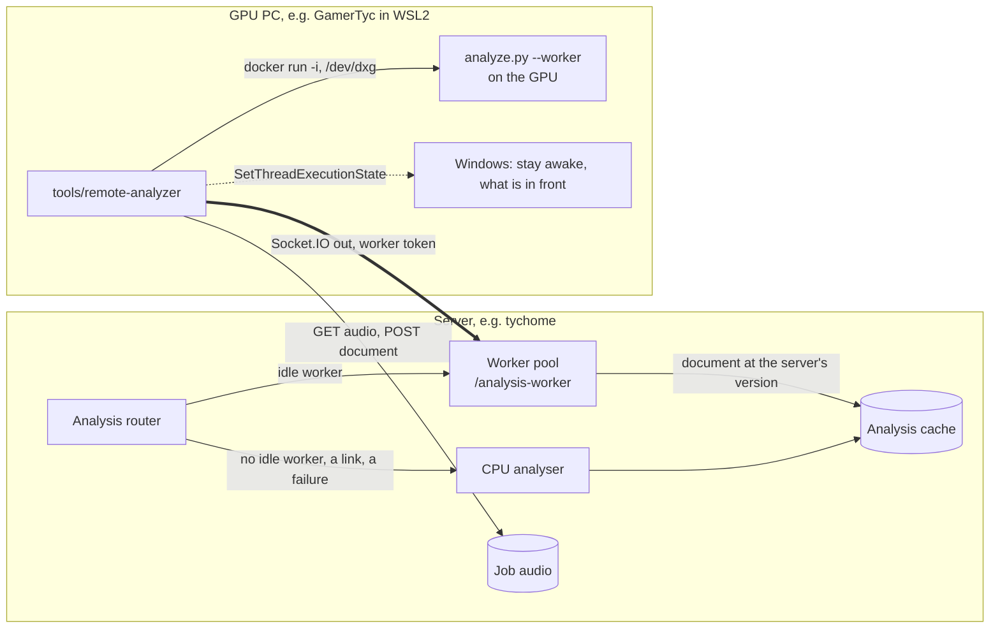

# Remote analysis on a GPU

The server analyses tracks on its own CPU. A PC with an NVIDIA card can take
that work: its worker connects out to the server, takes one job at a time, runs
the server's own analysis code in a container on the GPU and posts the
document back. The server stays the cache owner and falls back to its CPU
whenever no worker can take a job. This page is the worker's setup and the
protocol; the README's [Remote GPU analysis](../README.md#remote-gpu-analysis)
has the routing rules.



## What the worker checks

- **Code.** The server names its analysis version, `<schema>+<digest>`
  (`src/analysis-version.ts`). The worker finds the commit of
  `github.com/tyclab/lightshow` with exactly those files, checks them
  out under its data folder and verifies the digest before it runs them. The
  code never comes from the server. A `source` folder in the configuration
  replaces the lookup (for a development server); its own digest must match.
- **Environment.** `uv sync --locked --extra cu128` from that commit's
  `uv.lock`, inside the worker's runtime image, once per lock. Renovate's lock
  bumps build a new environment beside the old one; the worker declines jobs
  while it builds.
- **Models.** The worker lists its models with the same
  `scripts/download-models.py --list` the server uses. The server sends jobs
  only when the sets match, except that the worker may also hold SongFormer:
  structure `auto` runs it only on a GPU.
- **The desktop.** It declines jobs while a program other than the allowed
  browsers (`allowFullscreen`, the party visuals' Chrome) covers its whole
  monitor in front, or a Direct3D exclusive fullscreen runs, or other programs
  use more than `maxOtherVramMiB` (4096 MiB) of the card: GamerTyc's desktop with
  the party visuals idles at 2.4–3.3 GB of its 8 GB, and a job needs ~3.1 GB more. A game that comes to the
  front during a job stops it and gives the job back to the server, and the
  analysis container stops so the game has the card. While a job runs the
  worker holds `ES_SYSTEM_REQUIRED` so Windows does not sleep; the displays may.
- **Idle.** The container stays warm between jobs and stops after
  `idleStopMin` (15) minutes without one.

The container has no network, a read-only root and read-only mounts (only the
job's audio folder and tmpfs are new), drops every capability and runs as the
user: `--device /dev/dxg -v /usr/lib/wsl:/usr/lib/wsl:ro
-e LD_LIBRARY_PATH=/usr/lib/wsl/lib`, the WSL2 GPU without the NVIDIA container
toolkit. `ARTNET_PINNED_GB=0` is set: pinned host memory under WSL2 makes the
numpy work around the models ten times slower.

## Install on the PC

Needs Docker inside the WSL distro, the Windows NVIDIA driver (WSL2 sees the
card as `/dev/dxg`; `nvidia-smi` is `/usr/lib/wsl/lib/nvidia-smi`), Node 24+
and git. Nothing is installed system-wide: the worker keeps everything under
`~/.local/share/lightshow-remote-analyzer` (the data folder) and its
configuration in `~/.config/lightshow-remote-analyzer`.

1. **The agent.** A checkout of this repository at the data folder's `agent`,
   with the tool's one dependency:

   ```bash
   D=~/.local/share/lightshow-remote-analyzer
   git clone https://github.com/tyclab/lightshow.git "$D/agent"
   (cd "$D/agent/tools/remote-analyzer" && npm ci --omit=dev)
   ```

2. **The token.** Mint one for the server (below) and store it for the worker
   with mode 0600 at `~/.config/lightshow-remote-analyzer/token`, or give the
   service `LIGHTSHOW_WORKER_TOKEN`. It is never printed by the worker.

3. **The configuration**, `~/.config/lightshow-remote-analyzer/config.json`:

   ```json
   { "server": "http://10.27.2.42:3000", "tokenFile": "token", "name": "gamertyc" }
   ```

   | Key | Default | Meaning |
   |-----|---------|---------|
   | `server` | | The Lightshow's URL, no credentials |
   | `tokenFile` | | The worker token's file, relative to the configuration |
   | `name` | host name | The worker's name in the server's log and status |
   | `dataDir` | `~/.local/share/lightshow-remote-analyzer` | Code, environments, Python, jobs |
   | `modelData` | `<dataDir>/model-data` | `models/`, `.cache/torch`, `.cache/huggingface`, `panns_data/`: the server's `/data` layout |
   | `source` | | A fixed checkout instead of the lookup (development) |
   | `repo` | the GitHub repository | Where the analysis code comes from |
   | `image` | built from `Dockerfile` | Another runtime image |
   | `memory` | `16g` | The container's memory limit |
   | `gpuMemory` | `auto` | `ARTNET_GPU_MEMORY` (the card's memory policy) |
   | `maxOtherVramMiB` | `4096` | Decline while other programs use more of the card (MiB) |
   | `allowFullscreen` | `chrome`, `msedge`, `firefox` | Programs that may be fullscreen in front |
   | `idleStopMin` | `15` | Minutes without a job before the container stops |
   | `searchCommits` | `400` | How far back to look for the server's version |

4. **The models**, the server's exact weights: copy them from the server, e.g.
   from tychome (`/opt/lightshow/data` on the host):

   ```bash
   M=~/.local/share/lightshow-remote-analyzer/model-data; mkdir -p "$M"
   ssh root@tychome.internal.tycstation.com 'tar -C /opt/lightshow/data -c models .cache/torch .cache/huggingface' | tar -x -C "$M"
   ```

   `node cli.js prepare --fetch-models` downloads what is missing instead, with
   the `download-models.py` of the server's version (SongFormer needs that
   script: it fetches the config SongFormer loads offline), but from the
   models' current upstream revisions.

5. **Prepare and check.** `prepare` connects once, fetches the code, builds the
   runtime image and the CUDA environment (a few GB the first time) and
   compares the models; `check` shows what the worker would answer now.

   ```bash
   cd ~/.local/share/lightshow-remote-analyzer/agent/tools/remote-analyzer
   node cli.js prepare && node cli.js check
   ```

6. **The service**, a systemd user unit that restarts on any exit:

   ```bash
   cp lightshow-remote-analyzer.service ~/.config/systemd/user/
   systemctl --user daemon-reload && systemctl --user enable --now lightshow-remote-analyzer
   journalctl --user -u lightshow-remote-analyzer -f
   ```

   The user manager runs at the distro's boot only with lingering on
   (`loginctl enable-linger`); the distro itself boots when something starts
   WSL. If nothing does at Windows logon, a logon task running
   `wsl.exe -d <distro> --exec /bin/true` starts it.

To update the agent: `git -C ~/.local/share/lightshow-remote-analyzer/agent pull`,
then restart the service. The analysis code follows the server by itself.

## The token

`analysis.workerToken` on the server (Settings → Analysis → GPU Worker Token,
with Generate, or `settings.json`) is separate from `server.token`: it opens the
`/analysis-worker` namespace and `/api/analysis-worker/*` and nothing else, and
`server.token` does not open those. Blank turns remote workers off. A changed
token disconnects the connected workers; they reconnect once they hold the new
one. The settings API never returns it.

On tycstation the token belongs beside `vault_lightshow_token` in OpenBao:

- a `bao:seed-lightshow-worker-token` job, like `bao:seed-lightshow-token`,
  mints `vault_lightshow_worker_token` in `secret/tycpve/creds` if it is absent;
- both settings templates render it as `analysis.workerToken`
  (`lightshow-settings.json.j2`, and the `combine` in
  `lightshow-settings-rotated.json.j2`); the server reads it at start, so
  deploy:guests' restart (held while armed) applies it;
- the PC gets it from the operator's secret store into the token file
  (`bao kv get -field=vault_lightshow_worker_token secret/tycpve/creds`, piped
  straight into `install -m 600 /dev/stdin ~/.config/lightshow-remote-analyzer/token`),
  or on an enrolled box as its own sops-nix secret pointed to by `tokenFile`;
- tychome's nftables guard already lets the PC (10.27.2.80) reach port 3000.

## Protocol

Namespace `/analysis-worker`, `auth: { token }`. The worker sends:

- `hello` (ack): `{ protocol: 1, name, version, models, device: { kind, name, vramMiB }, available, reason }`;
  the answer is `{ ok, version, models, compatible, reason, settings }`.
- `status`: any of `available`, `reason`, `version`, `models`, `device`, on
  change and after every job.

The server sends:

- `job` (ack `{ accepted, reason? }` within 5 s): `{ id, key, version, ext, bytes, targetDurationSec, priority, settings: { separator, structureModel } }`.
  The server's file path stays on the server.
- `cancel`: `{ id, reason }`: superseded, preempted by the playing track, the
  other copy won, or past the limit (the local analyser's for that track).
- `server`: the `hello` answer again when the verdict changes.

Over HTTP, with `X-Lightshow-Worker-Token` and the job's `X-Lightshow-Job-Key`:
`GET /api/analysis-worker/jobs/:id/audio` and
`POST /api/analysis-worker/jobs/:id/result` with
`{ version, result | error, recycle?, yielded?, seconds? }` (gzip allowed, up to
64 MB). A result from another analysis version is answered 409 and the job runs
on the server.

## Comparing documents

Run on the same track, the worker's document matches the CPU's: the same beats,
downbeats, sections, drops, events, genre and mood; embeddings at cosine 1.0;
a handful of values in the last digits. Demucs's random shift is drawn from a
generator seeded with the file's SHA-256 (`track.hash`), so a file gets the
same shift on every run, in every process, however many tracks came before it.
Python's global `random`, which the model warm-up and earlier tracks move on,
is not read.

## Troubleshooting

`GET /api/analysis/workers` (UI token) shows each worker's compatibility and
why not, its availability and why not, the job it runs and the last jobs.

| The server says | Means |
|-----------------|-------|
| `its analysis code is …, this server's is …` | The worker is still preparing, or found no commit with the server's code (a server built from uncommitted code): see the worker's log |
| `its models differ from this server's: it lacks …` | Copy those models (step 4) and restart the service |
| `is not taking jobs: a fullscreen program is in front (…)` | As meant; add the program to `allowFullscreen` if it is the visuals |
| `is not taking jobs: other programs use … MiB` | As meant while a game holds the card; raise `maxOtherVramMiB` only if the card has ~3.2 GB beyond it |
| `gave … back: … disconnected` | The PC slept, lost the network or the service restarted; the server analysed it |
